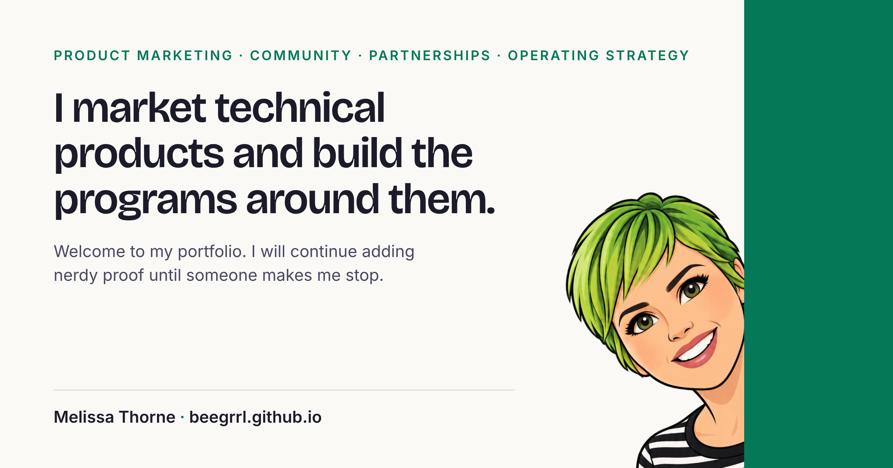

  

<strong>Product marketing, community, partnerships and operating strategy for technical products</strong>

<a href="https://beegrrl.github.io/">Portfolio</a>
·
<a href="https://www.linkedin.com/in/beegirl/">LinkedIn</a>

My work has been product and developer marketing, community and advocate programs, partner launches, and the strategy and operations work that keeps them running. I have 20+ years in technology, including 15+ years in developer and product marketing, at Sui Foundation, Chainlink Labs, Oracle, Salesforce, Zulily, Sony and Electronic Arts.

## Recent projects

**[Call-to-Card](https://beegrrl.github.io/call-to-card.html)** 
 
I built a tool that turns sales calls into competitor guides for reps. In a practice run, it promised mobile app support the rep couldn’t verify. I rewrote that answer.

**[One Offensively Orange Room](https://beegrrl.github.io/one-offensively-orange-room/)** 
 
I handed off a Sims building challenge through Muse, Meta’s AI assistant. In all three card tests, Muse credited me and chose where players would build. I’d left that to the host.

**[Patch Night](https://beegrrl.github.io/patch-night.html)** 
 
I measured a two-second delay in a simulated game launch on Fastly. My field guide helps sales and engineering tell a slow download from a slow account check.

[Call-to-Card source code](https://github.com/beegrrl/call-to-card) · [Interactive decision models](https://beegrrl.github.io/#models)

Seattle, WA · Remote · Open to senior roles in product marketing, community, partnerships, and strategy and operations.

_The degrees and certifications (along with several folks kind enough to [vouch](https://www.linkedin.com/in/beegirl/details/recommendations/?detailScreenTabIndex=0) for me as being a qualified human you should consider hiring) are on [LinkedIn](https://www.linkedin.com/in/beegirl/) for anyone curious._
