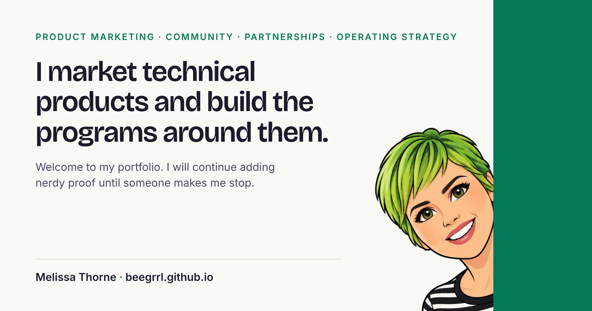

  

<h1 align="center">Melissa Thorne</h1>

<strong>Product marketing, community, partnerships and operating strategy for technical products</strong>

<a href="https://beegrrl.github.io/">Portfolio</a>
·
<a href="https://www.linkedin.com/in/beegirl/">LinkedIn</a>

My work has been product and developer marketing, community and advocate programs, partner launches, and the strategy and operations work that keeps them running. I have 20+ years in technology, including 15+ years in developer and product marketing, at Sui Foundation, Chainlink Labs, Oracle, Salesforce, Zulily, Sony and Electronic Arts.

### What's here

- **[call-to-card](https://github.com/beegrrl/call-to-card):** a TypeScript command-line tool I built in about 4 hours. It turns a recorded sales call into a one-page cheat sheet on a competitor. [Case study](https://beegrrl.github.io/call-to-card.html) · [Code](https://github.com/beegrrl/call-to-card)
- **Interactive decision models,** written and built by me in plain HTML, CSS and JavaScript. [See the portfolio](https://beegrrl.github.io/)

Seattle, WA · Remote · Open to senior roles in product marketing, community, partnerships, and strategy and operations.

_The degrees and certifications (along with several folks kind enough to [vouch](https://www.linkedin.com/in/beegirl/details/recommendations/?detailScreenTabIndex=0) for me as being a qualified human you should consider hiring) are on [LinkedIn](https://www.linkedin.com/in/beegirl/) for anyone curious._
